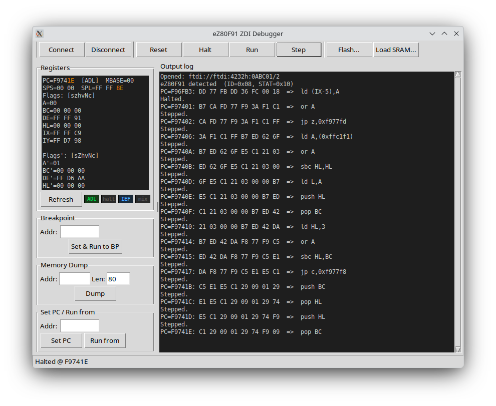

# ez80dbg — eZ80F91 ZDI Flash Loader and Debugger



A Python tool for flashing, loading, and debugging firmware on the **eZ80F91**
microcontroller via the **Zilog Debug Interface (ZDI)**.  Communication runs
over an FTDI FT4232H USB adapter using pyftdi.

---

## Features

| Feature | Description |
|---|---|
| **Flash / Load** | Write Intel HEX files to internal flash or SRAM |
| **Run / Halt / Step** | Full CPU control — run, halt, reset, single-step |
| **Breakpoints** | Set a hardware breakpoint, run, wait for halt, then step |
| **Registers** | Full register dump with inline eZ80/Z80 disassembly at PC |
| **Memory dump** | Hex dump any address range |
| **GUI** | Tkinter interface with register panel, disassembly and live log |
| **Monitor** | Unix-socket text protocol, command-compatible with the [NGZ80Evo emulator](../NGZ80Evo_Tools_Emu)'s `--monitor` — runs alongside the GUI |
| **ADL-aware disassembler** | Standalone `ez80dis.py` — decodes eZ80 prefixes (`.lil/.lis/.sil/.sis`), new eZ80 instructions, and 24-bit operands in ADL mode |

---

## Hardware requirements

| Component | Details |
|---|---|
| Adapter | FTDI FT4232H (Port B, MPSSE) |
| Target | eZ80F91 with ZDI pins exposed |
| Wiring | ZCL → Port B bit 0 · ZDA → Port B bit 1 and 2 wired together · needs about 10k PullUp to +3V3|

The default device string assumes serial number `0ABC01`, Port B.  
Override with `--device` if your adapter differs (see below).

---

## Installation

### Linux / macOS

```bash
git clone <repo-url>
cd ez80dbg
./setup.sh
```

**Linux — USB access without root:**

```bash
# udev rule for FT4232H
echo 'ATTRS{idVendor}=="0403", ATTRS{idProduct}=="6011", MODE="0660", GROUP="plugdev"' \
  | sudo tee /etc/udev/rules.d/99-ftdi.rules
sudo udevadm control --reload-rules
sudo usermod -aG plugdev $USER   # log out and back in
```

### Windows

```
setup.bat
```

pyftdi uses **libusb**, not the default FTDI D2XX driver.  
Replace the driver for FT4232H Interface B using [Zadig](https://zadig.akeo.ie/):
`Options → List All Devices → select Interface B → WinUSB → Install Driver`

---

## Usage

### CLI

```
usage: ez80dbg [-h] [--device DEV] [--gui]
               {flash,load,run,break,dump,regs,reset,monitor} ...
```

| Command | Synopsis | Description |
|---|---|---|
| `flash` | `<hexfile> [--run ADDR]` | Write HEX file to internal flash |
| `load` | `<hexfile> [--run [ADDR]] [--step]` | Load HEX file into SRAM |
| `run` | `<addr> [--step]` | Start execution at address |
| `break` | `<addr> [--reset] [--timeout SEC]` | Set breakpoint, run, wait, step |
| `dump` | `<addr> [<length>]` | Hex dump a memory region |
| `regs` | | Show CPU registers + disassembly at PC |
| `reset` | `[--run ADDR]` | Reset and halt CPU |
| `monitor` | `[<socket>] [--attach]` | Serve the Unix-socket debug protocol (default `/tmp/ez80dbg.sock`) |

**Tip:** Instead of prefixing every command with `venv/bin/python3`, activate
the venv once for the session:

```bash
source venv/bin/activate        # Linux / macOS
venv\Scripts\activate.bat       # Windows

python3 ez80dbg.py --help       # no venv prefix needed until shell is closed
```

**Examples:**

```bash
# Flash and run from firmware entry point
venv/bin/python3 ez80dbg.py flash firmware.hex --run 0x000000

# Load into SRAM and single-step from the start
venv/bin/python3 ez80dbg.py load firmware.hex --run --step

# Set breakpoint at 0xC000, run, wait up to 10 s
venv/bin/python3 ez80dbg.py break 0xC000 --timeout 10

# Hex dump 256 bytes at 0x40000
venv/bin/python3 ez80dbg.py dump 0x40000 256

# Use a specific FTDI adapter
venv/bin/python3 ez80dbg.py --device 0DEF02B regs
```

### Device string format

```
0ABC01B                      serial "0ABC01", port B  (default)
0ABC01A                      serial "0ABC01", port A
/2                           first FT4232H found, port B
ftdi://ftdi:4232h:0ABC01/2   full pyftdi URL
```

### GUI

```bash
venv/bin/python3 ez80dbg.py --gui
```

The GUI provides the same functionality via toolbar buttons.
Connect/Disconnect manages the FTDI link; all other buttons require an active
connection.  The **Monitor** toggle opens the Unix socket described below, so
a script can drive the target while you watch — see
[Monitor mode](#monitor-mode-unix-socket).

---

## Monitor mode (Unix socket)

A plain-text line protocol on a Unix domain socket at the fixed path
**`/tmp/ez80dbg.sock`**, so a client can hardcode it.  Available two ways.

### From the GUI (the usual way)

Press **Monitor** in the toolbar.  The button is a toggle: on opens the
socket, off closes it and removes the socket file.  Requires an active
connection, and takes the target exactly as you left it — no reset, no halt.

This is the intended workflow when the CPU needs hand-holding into a sane
state first: bring it up with the GUI buttons, then hand the same live ZDI
link to a socket client while the window stays usable.  Both sides share the
link under one lock, so whichever gets there first finishes its command before
the other starts — a `Halt` press mid-`continue` shows up on the socket as a
`BREAK` line, and a monitor `step` refreshes the register panel.

If the monitor is busy with a long operation (a `flash` runs for minutes), a
toolbar press waits up to 5 s and then logs `Busy: the monitor holds the ZDI
link` rather than corrupting the transaction.

Every socket command and its answer is echoed into the output log as a
transcript, so you can watch what a client is doing to the target:

```
socket> regs
        AF=1254 BC=001234 DE=005678 HL=019ABC
        ...
        OK
socket> continue
        running
        OK
socket< BREAK PC=001006
```

`socket>` is what the client sent, indented lines are what it got back, and
`socket<` marks a line it received without asking (a breakpoint hit).  Long
dumps are cut off after 12 lines — raise `MONITOR_TRACE_LINES` if you want
the full `mem` output in the window.

### From the CLI

```bash
venv/bin/python3 ez80dbg.py monitor [/path/to.sock] [--attach]
```

Halts the CPU and serves the same protocol standalone, without the GUI.
`--attach` skips the initial halt and takes the target as it is found.

The protocol is the same one the **NGZ80Evo emulator** speaks with
`ez80emu --monitor`, so a single client script can drive the emulator and real
silicon interchangeably.  Connect with anything that talks Unix sockets:

```bash
nc -U /tmp/ez80dbg.sock
socat readline UNIX-CONNECT:/tmp/ez80dbg.sock   # line editing/history
```

One command per line in; one or more response lines out, always terminated by
a line that is either `OK` or `ERR <message>`.  An unsolicited
`BREAK PC=xxxxxx` line arrives when a breakpoint fires while `continue` is in
effect.

| Command | Description |
|---|---|
| `regs` | Register dump (5 lines) |
| `mem <addr> [len]` | Hex + ASCII dump; addr and len in hex, len default `100` |
| `disasm <addr> [count]` | Disassemble `count` instructions (decimal, default 10) |
| `break <addr>` / `unbreak <addr>` / `breaks` | Manage breakpoints |
| `step [n]` | Execute n instructions (default 1) |
| `continue` \| `run` \| `c` | Start free-running; replies immediately |
| `pause` | Halt the CPU |
| `reset` | Reset and re-init the CPU |
| `quit` \| `exit` | Close the connection |

Four commands exist here that the emulator does not have (it answers
`ERR unknown command`), because a hardware target has no equivalent of the
emulator's command line:

| Command | Description |
|---|---|
| `load <hexfile>` | Load an Intel HEX file into SRAM |
| `flash <hexfile>` | Program an Intel HEX file into internal flash |
| `setpc <addr>` | Set PC without running |
| `help` | List commands |

### Data breakpoints

The four `ZDI_ADDRx` comparators match against the address bus, so the same
`break` command covers both cases (eZ80F91 PS019217, *ZDI Address Match
Registers*):

| Match on | When the break happens |
|---|---|
| An opcode fetch | Immediately, before the instruction runs |
| A data read or write | At the **end** of the instruction that made the access, so `PC` already points past it |

```
socket> break C000        # watch a RAM location
        breakpoint set at 00C000
        OK
socket> continue
        running
        OK
socket< BREAK PC=001005   # the instruction that touched C000 has completed
```

What ZDI cannot do, and what needs Zilog's OCI/JTAG block instead
(*On-Chip Instrumentation*, a separate 4-pin interface this tool does not
speak): break on a **data value** or masked value, break on an address
**range**, distinguish **reads from writes**, or trace history.

One extra ZDI trick this tool does not expose: `ign_low_0`/`ign_low_1`
(BRK_CTL bits 1 and 2) widen `ADDR0`/`ADDR1` to match anywhere in a 256-byte
page.  Only those two comparators have it — `ADDR2` and `ADDR3` are
exact-match only.

### Where hardware differs from the emulator

- **Four breakpoints, not sixteen** — the eZ80F91 has four ZDI address-match
  registers.  A fifth `break` answers `ERR too many breakpoints`.
- **`break` also works as a data watchpoint.**  The ZDI comparators watch the
  address bus, not just opcode fetches, so `break C000` on a RAM address
  breaks at the end of whichever instruction touches it — the emulator breaks
  on PC only.  There is no read/write qualifier, no code-vs-data distinction,
  and no data-value matching; the four comparators are shared between code and
  data breakpoints.  See [Data breakpoints](#data-breakpoints) below.
- **`regs` cannot report I, R and IM** — ZDI offers no read path to them, so
  they read as `0`; `IEF2` mirrors `IEF1` for the same reason.  Every field is
  still present, so a parser written for the emulator keeps working.
- **`regs`, `mem` and `disasm` need a halted CPU.**  While the target is
  free-running they answer `ERR cpu is running` rather than sample a moving
  target; `pause` first.
- **Disassembly text** comes from `ez80dis` here and from the emulator's own
  `zdis`.  The line shape is identical (`>`/`*` markers, 6-digit address, two
  spaces, mnemonic) but the two differ in spelling — `ld HL,0xc31234` vs
  `ld hl,0xC31234`.
- The greeting line is `ez80dbg monitor ready` rather than
  `ez80emu monitor ready`.
- **Only one client at a time**, as in the emulator.  Breakpoints and run
  state survive a disconnect, so a client can reconnect and carry on.

---

## Dependencies

| Package | Purpose |
|---|---|
| [pyftdi](https://github.com/eblot/pyftdi) | FTDI USB adapter access via libusb |
| [intelhex](https://github.com/python-intelhex/intelhex) | Intel HEX file parsing |
| [ez80dis](https://github.com/Matze584/ez80dis) | eZ80 Disassembler |
| tkinter | GUI Framework |

Install via `setup.sh` / `setup.bat`, or manually:

```bash
python3 -m venv venv
venv/bin/pip install pyftdi intelhex
```

---

## License

see [SPDX identifier](ez80dbg.py) in source header.

The Disassembler is based on z80dis (https://github.com/lwerdna/z80dis)
It is licensed under "The Unlicense". ez80dis is also. 

